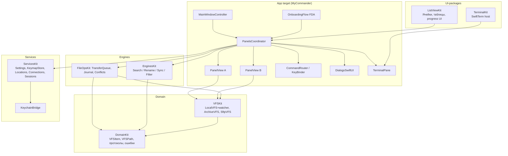

# 04. Архитектура

## 4.1 Высокоуровневая схема

Слои (сверху вниз, зависимости только вниз): **App / ListViewKit / TerminalKit → FileOpsKit / EnginesKit → VFSKit → DomainKit**, горизонтально — ServicesKit (используется всеми через протоколы из DomainKit).

## 4.2 SPM-модули и ответственность

| Модуль | Ответственность | Главные типы |
|---|---|---|
| **DomainKit** | Чистая модель: элементы, пути, атрибуты, ошибки, протоколы (VFS, Watcher, Stream), утилиты (маски, размеры) | `VFSItem`, `VFSPath`, `VFS`, `VFSCapabilities`, `FileWatchEngine`, `ByteStream`, `MCError` |
| **VFSKit** | Адаптеры: локальный том (+FSEvents), архивы, SFTP; пул подключений | `LocalVFS`, `ArchiveVFS`, `SftpVFS`, `FSEventsWatcher` |
| **FileOpsKit** | Движок операций: планирование, транзакции, конфликты, пауза/отмена, журнал/undo | `TransferQueue`, `Operation`, `ConflictResolver`, `JournalStorage` |
| **EnginesKit** | Утилитные движки: quick filter, поиск, multi-rename, sync/compare | `FilterEngine`, `SearchEngine`, `RenamePlanner`, `SyncReporter` |
| **ListViewKit** | AppKit-UI: панельные таблицы, табы, диалоги прогресса, кернинг cell-звен, Lister-окно | `FileListView`, `PanelViewModel`, `ListItemCell`, `ProgressWindow`, `ListerWindow` |
| **TerminalKit** | Обёртка SwiftTerm: PTY, тем, enter-cd интеграция | `TerminalPane`, `ShellSession` |
| **ServicesKit** | Настройки/состояние: settings model, keymap, технологии персистентности, Connections, | `SettingsStore`, `KeymapStore`, `LocationsStore`, `ConnectionStore`, `SessionStore` |

DI — конструкторами вручную (без контейнеров): явные графы, легко тестировать fake-ами. Слои общаются асинхронно (async/await, actors) и событиями `AsyncStream`.

## 4.3 Потоки данных (ключевые сценарии)

**Открытие каталога:**
1. UI (`PanelView`) → `PanelsCoordinator.open(path)` → `LocalVFS.listDirectory("  path") async`.
2. VFS возвращает `[VFSItem]` + ревизию (`revision: UInt64`).
3. UI применяет сортировку/фильтр через `FilterEngine` → diff vs прошлый список → батч-обновление `NSTableView` (`reloadItems(indices)`), держит ancillary cache `ItemCache`.
4. `FSEventsWatcher` подписан на путь: события → coalesce 300 мс → `lstat`-дифф → `PanelEvent.itemsChanged(diff)` → пункт 3.

**Копирование (F5):**
1. KeyBinder → `CommandRouter.copy()`.
2. `TransferQueue.planCopy(items, target)` — строит `TransferPlan` (детект clonefile/конфликтов поверх `stat`).
3. Если конфликты — `ConflictResolver` вызывается из UI (диалог).
4. `OperationExecutor` (actor, 4 воркера) выполняет транзакции per-file: temp/copyfile/rename/clonefile/verify-size.
5. Прогресс → `AsyncStream<TransferEvent>` → ProgressWindow; панель B обновляется через watcher (не дубликация).
6. Journal пишет запись (для undo); итог — summary.

**SFTP-сессии:** `ConnectionStore` → `SftpVFS(SSHSession)` с lifetime-политикой: idle 5 мин, reconnect backoff 1/2/4/8 с (max 5), host key pinning на первый accept (диалог).

## 4.4 Конкурентность

- **MainActor**: вся AppKit/прогресс-UI; модели панелей — `@MainActor final class PanelViewModel`.
- **Акторы**: `OperationExecutor`, `SftpVFS` (per-connection), `ArchiveReader` (per-open), `SettingsStore` (обёртка MainActor).
- **Sendable**: `VFSItem` — value тип (struct) в состоянии domain; большие списки передаются по копии (допустимо; cache-эффективно).
- Канцелярия: все long-операции — cancellation-check через `Task.isCancelled` каждые I/O-итерацию.

## 4.5 Обработка ошибок

- Единая таксономия `MCError` (см. `05`), errno-след (сохраняем original `POSIXError` в `underlying`).
- Пользовательская панель получает `ReadableMessage` (локализуемый шаблон), диалоги прогресса — retry/skip/cancel.
- Логи: `os.Logger(subsystem: app, category:…)`, privacy-макросы для путей.

## 4.6 Композиция панелей и операций (инвариант)

- Источник > операция идёт **из активной панели** (focus) в **противоположную** (или другой таб/путь) — epitome старой школы; Confirm onStart switchable.
- Панели никогда не запускают операции сами — только через `CommandRouter` (single dispatch), что делает клавиши remappable и операции тестируемыми.
